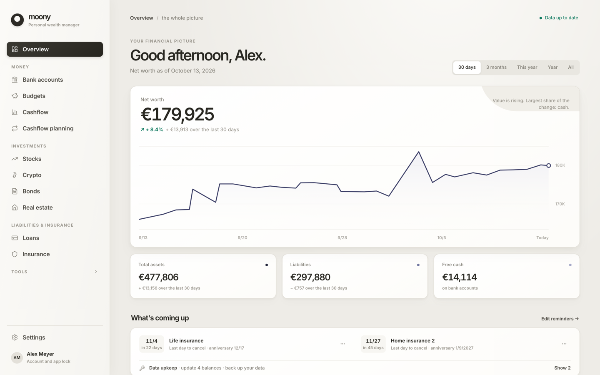
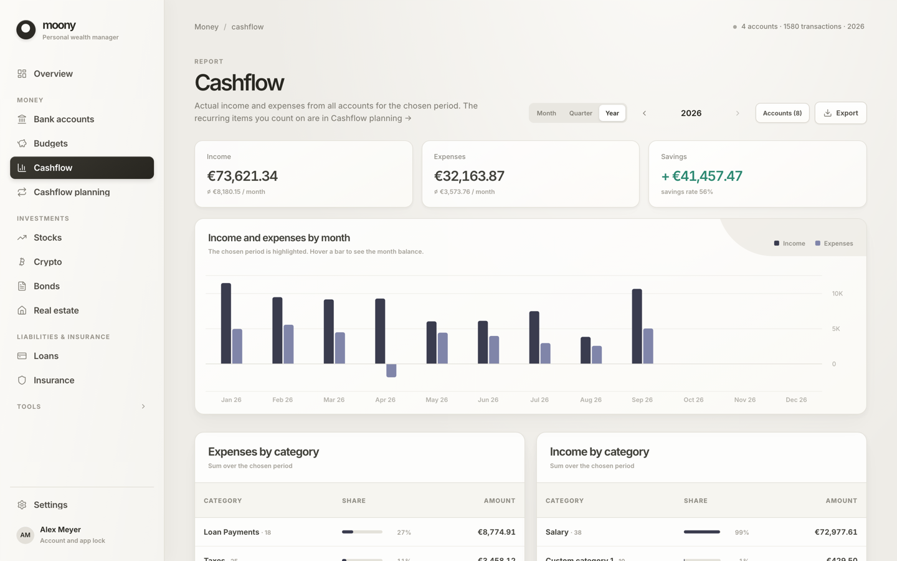
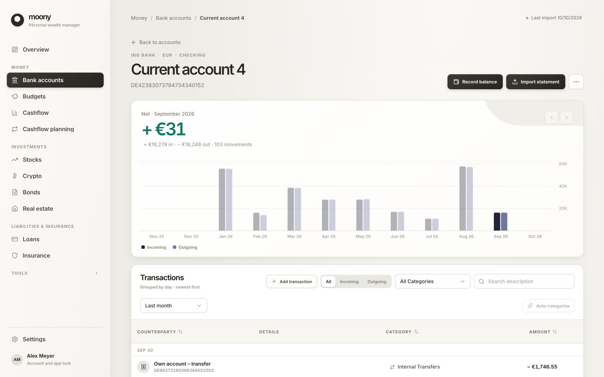
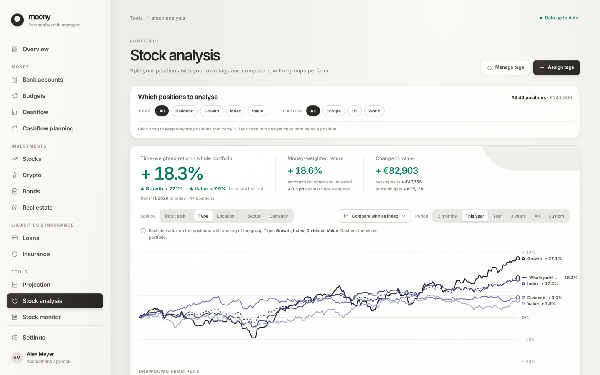
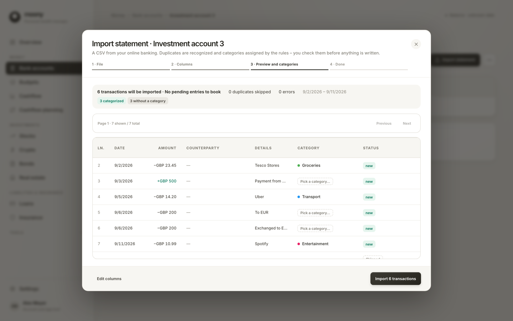
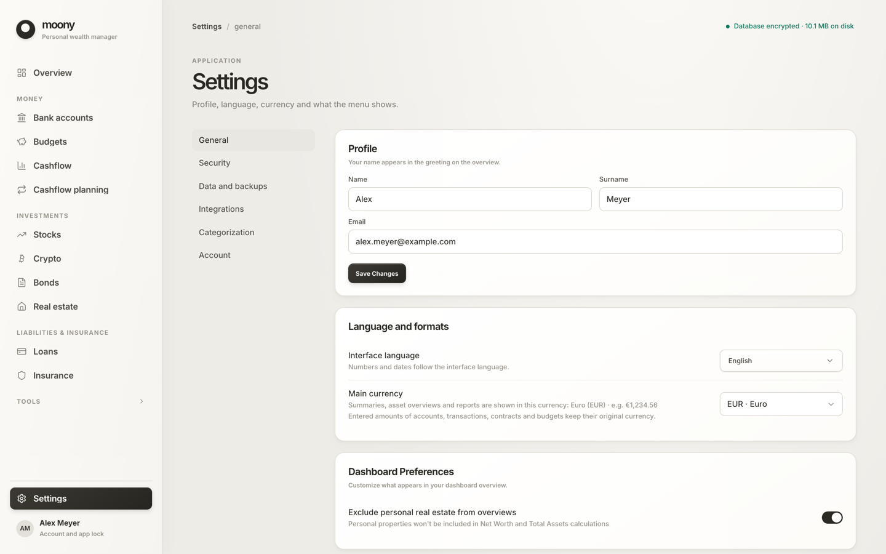

<div align="center">


# Moony

**Your whole net worth. Only on your computer.**

[](https://github.com/fiiles/Moony/actions/workflows/ci.yml)
[](https://github.com/fiiles/Moony/releases/latest)
[](./LICENSE)

macOS · Windows · Linux · ten languages

</div>

Moony tracks your bank accounts, stocks, crypto, bonds, real estate, loans and insurance in one
net-worth view, in ten languages and 45 currencies. There is no account, no cloud and no sync:
your records, photos and documents live AES-256 encrypted on your computer (exports and copies
you open in other apps are readable, see [Privacy and security](#privacy-and-security-at-a-glance)). The app contacts the
internet only for market data and update checks, all listed in [PRIVACY.md](./PRIVACY.md).

<p align="center"></p>
<p align="center">  </p>
<p align="center"> </p>

The screenshots show a sample profile (synthetic data).

## Who it is for

Moony is for people with several accounts, investments, loans and insurance policies who want
one net-worth number and do not want to hand their statements to a service. It is not the
right tool today if you need automatic bank sync (you import bank statements or enter data yourself), a phone or
tablet app, or a budget shared by a household (one profile on one computer, no sync).

## What it does

- **Net worth and its history** across bank accounts, stocks, crypto, bonds, real estate, loans,
  insurance and other assets. A *What's coming up* agenda lists insurance notice deadlines,
  fixed-rate ends, maturities, larger payments and watchlist targets that were reached.
- **Bank accounts** with statement import (CSV with 16 bank presets and column detection for other
  files, and CAMT.053, MT940, OFX/QFX and QIF statements; a preview, duplicate skipping, one-click
  undo) and an account page built around dated balance records. Categorization uses your own
  rules, rules learned from your choices and rule packs for many countries.
- **Stocks** with prices from Yahoo Finance (or set by hand), dividends and a watchlist that
  never counts toward net worth. Broker CSV import reads XTB, Trading 212, Degiro and
  Interactive Brokers exports and your own table. The analysis shows time-weighted and
  money-weighted return, drawdown, each position's contribution, deposits against gain and an
  optional comparison with S&P 500 or MSCI World.
- **Crypto, bonds, other assets, real estate, loans and insurance**, with dated valuations,
  rental income, recurring costs, linked loans and policies, loan schedules and attachments.
- **Budgets, cashflow and planning:** a cashflow report by month, quarter or year, cashflow
  planning with categories as groups (any row or category can be left out of the plan), a
  net-worth projection, and annuity and real estate investment calculators. Budgets show
  spending against the limits; one "Manage budgets" dialog lists each category's limit in
  effect with its scheduled changes and earlier limits. A limit can run from one month to
  another (the earlier limit returns afterwards) or for good; the newest limit replaces the
  ones it overlaps after a warning, and equal neighbouring limits merge. Deleting a budget removes all its
  limits, past months included; deleting one earlier limit removes exactly that interval
  without extending earlier limits into the gap.
- **Ten languages and 45 currencies.** English, Czech, German, Spanish, Italian, Norwegian
  (bokmål), Polish, Swedish, Japanese and Simplified Chinese; the languages other than English
  and Czech are machine-translated and [corrections are welcome](./CONTRIBUTING.md#translations).
  The main currency can be any of the 36 that have an exchange-rate source; every amount keeps its
  own currency and nothing is converted 1:1 or at an invented rate ([details](./docs/currencies.md)).
- **Light and dark.** Settings → General → Appearance: System (follows macOS, Windows or Linux),
  Light or Dark.

**Bank presets**, recognized from the header row of an export. Fintechs: Revolut, Wise, N26.
Germany: Sparkasse, DKB\*, ING Germany\*. United Kingdom: a generic debit/credit layout. United
States: Chase. Czech Republic: Fio, Česká spořitelna, Komerční banka\*, Air Bank\*, ČSOB\*,
MONETA\*, and mBank\* and Raiffeisenbank\* in their Czech export formats (the same brands in
other countries are not covered). \* No sample file in the tests yet: these are checked only
against a synthetic file built from the preset itself and stay best-effort until someone with
that bank confirms them. If your file is not recognized or maps wrongly, open an issue with the
header row only. A new bank is one small JSON file, see
[CONTRIBUTING.md](./CONTRIBUTING.md#adding-a-bank-preset).

## Download and install

Get the installer from the [latest release](https://github.com/fiiles/Moony/releases/latest)
(all versions: [Releases](https://github.com/fiiles/Moony/releases)). Builds: macOS (Apple
Silicon and Intel), Windows (x64), Linux (x86_64, built on Ubuntu 24.04).

> **Moony's installers are not code-signed yet.** Signing needs an Apple Developer Program
> membership and a Windows code-signing certificate, which the project does not have; it is
> planned (see [ROADMAP.md](./ROADMAP.md)). Until then macOS and Windows show a warning the first
> time you open the app. The app is not damaged: follow the steps below once. Updates inside the
> app are verified with the project's own signature either way.

<details>
<summary><strong>macOS</strong></summary>

1. Download `Moony_<version>_aarch64.dmg` for Apple Silicon (M1 and newer) or
   `Moony_<version>_x64.dmg` for Intel Macs.
   Not sure which Mac you have? Apple menu → **About This Mac**: the *Chip* line says
   *Apple M…* or *Intel*.
2. Open the `.dmg` and drag **Moony** into **Applications**.
3. Open **Terminal** (Applications → Utilities) and run this once:

   ```bash
   xattr -cr /Applications/Moony.app
   ```

   It removes the "downloaded from the internet" mark that makes macOS say *"Moony is damaged
   and can't be opened"* (Gatekeeper). Then open Moony as usual.

   If macOS instead says it *cannot verify the developer*, you can also go to **System
   Settings → Privacy & Security**, scroll to *Security* and click **Open Anyway** next to
   Moony.

</details>

<details>
<summary><strong>Windows</strong></summary>

1. Download `Moony_<version>_x64-setup.exe`. If the browser says the file is not commonly
   downloaded, keep it (in Edge: **⋯ → Keep → Show more → Keep anyway**).
2. Run it. Windows SmartScreen may show *"Windows protected your PC"*. Click **More info**,
   then **Run anyway**.
3. Moony needs the Microsoft Edge WebView2 runtime, which is preinstalled on Windows 10 and 11;
   the installer fetches it if it is missing.

</details>

<details>
<summary><strong>Linux</strong></summary>

- **AppImage:** `chmod +x Moony_<version>_amd64.AppImage && ./Moony_<version>_amd64.AppImage`
  (some distributions need `libfuse2` for AppImages).
- **Debian / Ubuntu:** `sudo apt install ./Moony_<version>_amd64.deb`
- **Fedora / openSUSE:** `sudo dnf install ./Moony-<version>-1.x86_64.rpm`

</details>

## Try it with sample data

A downloadable demo profile is planned ([ROADMAP.md](./ROADMAP.md)). For now you need the Rust
toolchain to generate one with synthetic finances: `cd src-tauri && cargo run --bin seed_demo`
writes `../demo-home/` (unlock password `demo1234`). How to run the app against it is in
[CONTRIBUTING.md](./CONTRIBUTING.md#demo-data). Never point the generator at a folder that holds
real data.

## First run and updates

A brief, skippable welcome leads into a wizard: main currency and country, a name and password,
your **recovery key** (save it: it is the only way to reset a forgotten password), what to track,
and optionally a first account and a statement import. After you unlock Moony it asks GitHub
whether a newer version exists and offers a one-click update, verified against the project's
public key; switch the check off in *Settings → Security → Updates*.

## Privacy and security at a glance

The checkable version is **[PRIVACY.md](./PRIVACY.md)**; vulnerabilities go through **[SECURITY.md](./SECURITY.md)**.

- **Local-first.** AES-256 encrypted SQLite databases (SQLCipher) in your user profile: one for
  your records, one for the photos and documents you attach. No account, no cloud, no sync, and no
  telemetry: no analytics, no usage statistics, no crash reports.
- **What leaves your computer.** Ticker symbols, ISINs, crypto IDs, search text, currencies and
  date ranges go to Yahoo Finance, CoinGecko and Frankfurter for prices and rates; the ECB's daily
  rates are downloaded, and the update check goes to GitHub. Balances, amounts, names and
  documents are not sent (an AI client you connect through MCP is the exception).
- **Not encrypted.** The JSON export, copies you save, and the temporary copy of a document you
  open in another app (Moony deletes it when you lock or quit). Images and PDFs open inside Moony.
  Use full-disk encryption as well.
- **Password and recovery key.** Your password and, as a fallback, a 24-character recovery key
  protect the database key. There is no backdoor: without both, nobody can open your data,
  attachments included.

## Data and backups

Your data lives in one folder per user, named after the app identifier `com.moonyfinance.desktop`
(`~/Library/Application Support/` on macOS, `%APPDATA%\` on Windows, `~/.local/share/` on Linux).
It holds the database (`moony.db`), the encrypted attachments (`attachments.db`) and the key files
(`salt`, `key.enc`, `recovery.enc`). **Settings → Data and backups** shows the exact path, the state
of your attachments, and offers:

- **Back up now:** one ZIP with consistent, still encrypted snapshots of both databases and the
  key files.
- **Restore from backup:** replaces your data; the current data is moved to a `pre-restore-…`
  folder first, never deleted. Unlock with the password that belongs to the backup. Also on the
  lock screen and in the first-run wizard, so a new computer needs no throwaway account.
- **Export all data (JSON):** a plain-text dump of your records, without attachment files, API
  keys and the MCP token. **Verify database:** an integrity check.

Moony never uploads your records or backups, so keep your own copies; the recovery key works
only together with the key files. *Settings → Account → Delete data…* does not remove
`pre-restore-*` folders, see [PRIVACY.md](./PRIVACY.md#deleting-your-data).

## AI assistant (MCP), optional

Moony can serve your data to an AI assistant such as Claude over the Model Context Protocol. It
is off by default, listens on `127.0.0.1` only, needs the app to be unlocked and a bearer token,
and offers 44 tools that read and, in part, write your data. The assistant processes whatever it
reads, usually in its provider's cloud ([setup](./docs/mcp.md)).

## Data sources and attribution

- **Yahoo Finance** supplies stock prices, history, dividends, ticker search and company data, and crypto price history older than a year
  through an unofficial, undocumented interface used by a community library
  ([`yahoo_finance_api`](https://crates.io/crates/yahoo_finance_api)). It can change, break or be
  rate-limited without notice, and Moony is not affiliated with Yahoo. A price can always be set
  by hand.
- **CoinGecko** supplies crypto prices. Price data by [CoinGecko](https://www.coingecko.com).
- **European Central Bank** (daily euro reference rates; source: ECB, published for information
  purposes only) and **[Frankfurter](https://frankfurter.dev)** (rate history) supply exchange rates.

**Moony is not financial, tax or investment advice.** Prices, rates and calculated figures can be
wrong or out of date; check anything that matters against your bank and broker statements.

## Status and compatibility

Moony 1.0 is the first stable release. Your database is upgraded in place by append-only
migrations, and Moony first copies it next to itself (`moony.db.bak-<time>`, the newest three are
kept). That is a safeguard, not a guarantee: keep your own backup, because an older version
refuses a database that a newer one has migrated. If you come from 0.10.0 or older, read
[Where your data lives](./PRIVACY.md#where-your-data-lives) first: the data folder was renamed in
0.11.0. The MCP tool names and result shapes have changed only by additions and documented fixes
since 0.10.0; if a later release changes them incompatibly, [CHANGELOG.md](./CHANGELOG.md) says
so. Plans are in [ROADMAP.md](./ROADMAP.md).

## Built with AI assistance

Moony is developed by one maintainer working with AI coding agents. They follow written rules
([AGENTS.md](./AGENTS.md), [`docs/standards/`](./docs/standards/)) and a tiered process
([`workflow.md`](./docs/standards/workflow.md)): a design and a plan for larger changes, tests
first for fixes, and gates every change must pass (lint, type check, unit tests, clippy and
`cargo audit` in CI). That reduces mistakes but does not remove them; please report what you find.

## Help and community

- **Questions and ideas:** [GitHub Discussions](https://github.com/fiiles/Moony/discussions).
- **Bugs:** [open an issue](https://github.com/fiiles/Moony/issues/new/choose) with the bug
  report form, and never paste balances or statements. More in [SUPPORT.md](./SUPPORT.md).
- **Security problems:** follow [SECURITY.md](./SECURITY.md); do not file a public issue.
- **Contributing:** [CONTRIBUTING.md](./CONTRIBUTING.md), [Code of Conduct](./CODE_OF_CONDUCT.md).

## License

Copyright © 2024-2026 Filip Král

Moony is free software: you can redistribute it and/or modify it under the terms of the
**GNU Affero General Public License v3.0** as published by the Free Software Foundation. You may
use, study, modify and share it, forks included; [LICENSE](./LICENSE) says what that requires of
modified versions.

The name "Moony" and the app icon are not covered by this license; a modified version should use
a different name and icon. A commercial license is available on request: ask in
[GitHub Discussions](https://github.com/fiiles/Moony/discussions).

Moony is distributed WITHOUT ANY WARRANTY; without even the implied warranty of
MERCHANTABILITY or FITNESS FOR A PARTICULAR PURPOSE. The licenses of the npm packages and Rust
crates it is built from are in [THIRD_PARTY_LICENSES.md](./THIRD_PARTY_LICENSES.md).
